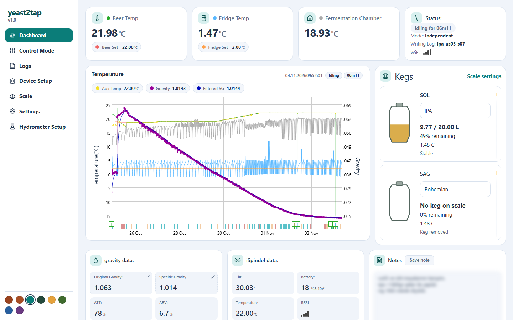
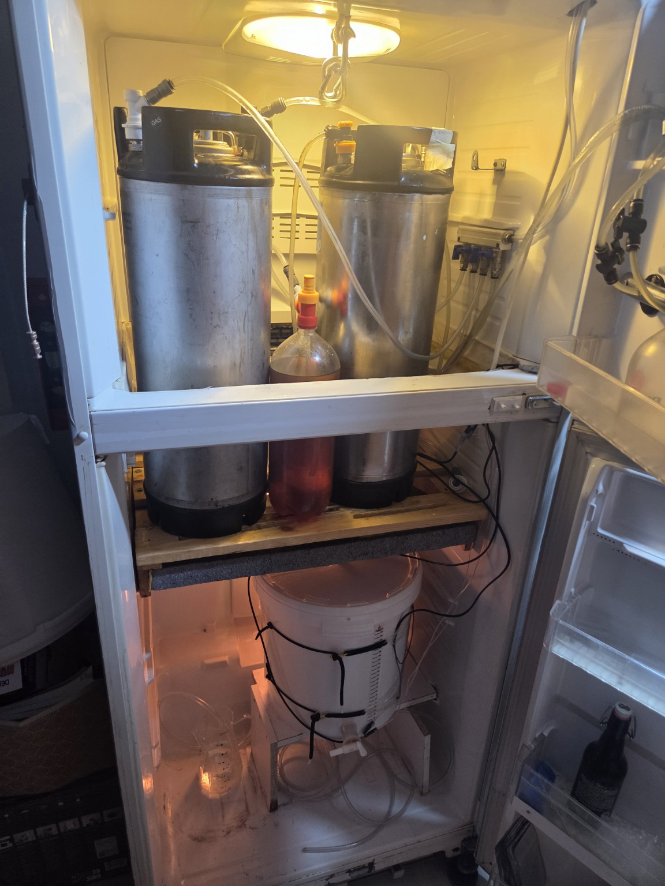

# yeast2tap

[](https://github.com/asdafe/yeast2tap/actions/workflows/build.yml)
[](LICENSE)
[](https://github.com/asdafe/yeast2tap/releases)

A fermentation temperature controller that runs entirely on a single ESP32. No Raspberry Pi, no
PC, no cloud account: the controller, the schedules and the web interface live in one firmware
image, and you reach it from a phone or a laptop on the same network.



The controller runs in one fridge. This is the reference build — the same chamber in two jobs at
once: kegs on top, a fermenting bucket below, the two halves separated by a sheet of foam insulation
so each side holds its own temperature.



---

## What it does

- **Temperature control for one fermentation chamber** — heating, cooling, fan, light, door,
  humidity and glycol, all from the same device.
- **Beer, Fridge, Profile and Independent control** — a PID-driven beer setpoint, a direct fridge
  setpoint, time- and gravity-based schedules, or separate heater/cooler thresholds that may run
  at the same time.
- **Beer profiles** — up to 10 steps, with temperature ramps and time, gravity, stable-gravity or
  manual advance conditions. An Easy Ramp wizard builds the common lager/ale schedules.
- **Keg scales** — up to eight HX711 load cells, with tare/factor calibration, empty-keg mass,
  daily weight history, consumption tracking and temperature correction.
- **Hydrometers** — iSpindel/GravityMon over HTTP, Tilt and RAPT Pill over BLE, plus manual
  original gravity.
- **Local logging and an offline viewer** — record a fermentation, revisit it in the browser,
  export CSV, and run capping or temperature-correction views on the stored log.
- **Remote logging and MQTT** — Brewfather, Brewer's Friend, ThingSpeak, Ubidots or a generic HTTP
  endpoint; MQTT for both publishing and remote control.
- **Optional subsystems** — pressure transducer, auto-capping, humidity control, glycol loop and
  DS2413 1-Wire outputs.
- **Local display and controls** — 20×4 I²C LCD, SSD1306 OLED, rotary encoder, buttons and buzzer.
- **DuckDNS** — optional dynamic-DNS updates from the Settings page.
- **Eight interface languages** — English, Chinese, Italian, Norwegian, Portuguese (BR), Slovak,
  Spanish and Turkish.

The Pressure page is hidden until it is enabled in Settings. Everything else is always present.

---

## How it differs from BrewPiLess

yeast2tap descends from [BrewPiLess](https://github.com/vitotai/BrewPiLess), which proved that a
whole BrewPi controller fits on one cheap ESP8266. It keeps that protocol — the same `j{mode,…}`
messages, the same device JSON, the same web sockets — so a BrewPiLess client or a Brewfather
integration keeps working. What it adds on top:

- **Keg scales.** Up to eight HX711 load cells with daily weight history, empty-keg mass,
  consumption tracking and temperature correction. BrewPiLess has no keg tracking at all.
- **Hydrometers beyond iSpindel.** Tilt and RAPT Pill over BLE as well as iSpindel/GravityMon over
  HTTP, and the gravity readings feed the profile conditions.
- **An independent control mode** where the heater and the cooler have separate thresholds and may
  run at the same time — useful for a chamber doing two jobs.
- **A local log viewer** in the browser: open a finished fermentation, export it as CSV, replay
  capping or temperature-correction views without any external tool.
- **Eight interface languages**, including Turkish, and a rewrite of every page rather than an
  inherited skin.
- **Fixes for inherited defects**, not just new features: device/actuator persistence, scale
  calibration actually saving, the config page sending dot decimals, and the cap-schedule restore.

It is also **ESP32-only and one chamber deep**: chamber 1 and beer 1 are the only reachable slots,
and nothing here has been run on an ESP8266 build. If you need multiple chambers on an ESP8266, stay
with BrewPiLess.

---

## Hardware

| | |
|---|---|
| Controller | ESP32 WROOM, **4 MB flash** (`esp32dev` board definition) |
| Framework | Arduino for ESP32, `espressif32@~6.8.1` |
| Flash layout | two OTA app slots of 1,769,472 bytes + a 589,824-byte LittleFS partition |
| Minimum build | one beer probe, one fridge probe, one heater relay, one cooler relay, 5 V supply |

Electrically and sensor-wise this is compatible with existing BrewPiLess-style builds — the same
boards, sensors and default pin assignments work — but only the ESP32 WROOM 4 MB module is tested.

Fixed pins and reservations:

- 1-Wire bus: **GPIO 23** (all DS18B20 sensors and DS2413 outputs)
- I²C: **GPIO 21 (SDA), 22 (SCL)**
- Rotary encoder (enabled by default): **GPIO 13, 14, 18** — these pins cannot be used by a scale;
  the two keg scales use **25/26** and **27/33**
- Flash: **GPIO 6–11** (never usable)
- Input-only: **GPIO 34, 35, 36, 39** — fine for HX711 data or a door switch, never for a clock or relay
- Boot-strapping: **GPIO 0, 2, 5, 12, 15** — avoid for relays

No devices are assigned at first boot. You choose every sensor and actuator on the Device Setup
page, so the same firmware fits different builds. See
[Wiring and pins](documentation/install/02-wiring-and-pins.md) before connecting anything.

---

## Quick start

### Flash a ready build (no toolchain)

Two prebuilt images are published with every release. Both target the same ESP32 WROOM 4 MB board;
they differ only in the build flags, so pick one and flash it — you do not need PlatformIO, a
compiler, or a Git checkout.

| Image | What is in it | Download |
|---|---|---|
| **Standard** (`esp32`) | the default build: humidity support, rotary encoder, no serial debug | [**yeast2tap-0.2.4-esp32.bin**](https://github.com/asdafe/yeast2tap/releases/latest) |
| **Developer** (`esp32-dev`) | `LogBufferSize=128`, BTHome sensor support, rotary encoder off, serial debug off | [**yeast2tap-0.2.4-esp32-dev.bin**](https://github.com/asdafe/yeast2tap/releases/latest) |

Both files are **single merged images** — bootloader, partition table and application in one binary
that is written at address `0x0`. Flash it with the
[esptool](https://github.com/espressif/esptool) command below, or with any GUI flasher (NodeMCU
PyFlasher, ESP32 Flash Download Tool) using the same offset.

```bash
esptool.py --chip esp32 --port COM5 erase_flash
esptool.py --chip esp32 --port COM5 --baud 460800 write_flash 0x0 yeast2tap-0.2.4-esp32.bin
```

Linux and macOS use `/dev/ttyUSB0` or `/dev/cu.usbserial-*` instead of `COM5`. If flashing fails,
hold **BOOT** while the tool connects.

### First run

1. On a blank device, join the open Wi-Fi network **`yeast2tap`** and open `http://192.168.4.1`.
   `http://yeast2tap.local` also works once mDNS resolves, but Android has no mDNS resolver, so on a
   phone use the IP address.
2. If one browser refuses the page, try another before suspecting the device. Chrome on Android
   treats the access point as a captive portal — the firmware does not answer `/generate_204`, so
   Chrome can sit in an `ERR_TOO_MANY_RETRIES` loop while the device is perfectly reachable.
   Granting Chrome the **Nearby devices** permission and force-stopping it once clears that state;
   after reopening, `http://192.168.4.1` loads normally.
3. Log in with **`yeast2tap` / `yeast2tap`** and change the password on the Settings page.
4. Join your own network on Settings → Network, then reopen the interface at its new address.
5. Assign your probes and relays on **Device Setup**, then pick a control mode on **Control Mode**.

The interface has eight pages: Dashboard, Control Mode, Logs, Device Setup, Scale, Settings,
Hydrometer Setup, and Pressure (hidden until enabled).

Firmware updates are served by a second web server on **port 8008**:
`http://<device>:8008/systemupdate`. OTA writes the inactive app slot, so a failed upload falls
back to the running firmware, and your settings and logs survive.

The file system can be wiped from `http://<device>:8008/fsformat` (login required). That erases
logs, profiles and other files but keeps the EEPROM-backed settings. See
[Recovery](documentation/troubleshooting/06-recovery.md).

---

## Build from source

```bash
git clone <this repository>
cd yeast2tap
pio run -e esp32             # build
pio run -e esp32 -t upload   # flash over USB
```

`esp32` is the tested environment and the first entry in `default_envs`, so a bare `pio run`
builds it too. It uses `partition2.csv`: two OTA slots plus a 576 KB data partition.

`esp32-dev` is the second published image and builds the same board with a different set of flags
(`src/Config.h` documents each one). Build either environment and merge it into a single file:

```bash
pio run -e esp32
esptool.py --chip esp32 merge_bin -o yeast2tap-esp32.bin \
  --flash_mode dio --flash_freq 40m --flash_size 4MB \
  0x1000 .pio/build/esp32/bootloader.bin \
  0x8000 .pio/build/esp32/partitions.bin \
  0xe000 ~/.platformio/packages/framework-arduinoespressif32/tools/partitions/boot_app0.bin \
  0x10000 .pio/build/esp32/firmware.bin
```

The build is **tight**: the app uses about 98.7 % of its 1,769,472-byte slot (roughly 23 KB free),
and static RAM is around 20 %. Check the memory summary at the end of every build before adding a
feature.

The web interface is compiled into the firmware. Only touch it if you change something under
`htmljs/src`:

```bash
cd htmljs
npm install
npm run embed
cd ..
```

Then delete `.pio/build/esp32/src/EmbeddedFiles.cpp.o` before rebuilding, or PlatformIO will keep
serving the old pages. `npm run embed` also runs the i18n check, which fails on a missing locale
key.

Other environments exist (`esp32-oled`, `esp32-tr`, `esp32-sonoff`, ESP8266 variants, …), but
`esp32` is the one this documentation describes. Feature flags live in `src/Config.h` and
`src/ConfigDefault.h`; see [Build and feature flags](documentation/reference/11-build-and-flags.md).

---

## Documentation

The full manual is in [`documentation/`](documentation/README.md), derived from the source code of
this repository rather than from upstream material.

| You want to… | Read |
|---|---|
| Build the hardware and flash it the first time | [Installation](documentation/install/01-hardware.md) |
| Learn the dashboard and control modes | [User guide](documentation/user/01-getting-started.md) |
| Set up a hydrometer or a keg scale | [Hydrometers](documentation/user/07-hydrometers.md) · [Keg scales](documentation/user/08-keg-scales.md) |
| Fix something that stopped working | [Troubleshooting](documentation/troubleshooting/01-web-and-network.md) |
| Integrate over HTTP, WebSocket or MQTT | [HTTP API](documentation/reference/02-http-api.md) |

Reference pages cite the source files and functions they were derived from, so every statement can
be checked against the build you actually run.

---

## Known limitations

These are properties of the current build, not configuration mistakes:

- **One chamber, one beer.** The device model has more slots, but only chamber 1 and beer 1 are
  reachable.
- **No TLS.** The web interface is plain HTTP with Basic authentication, intended for a trusted
  network. Port 8008 (OTA upload, file manager) is unauthenticated except for `/fsformat`.
- **Manual SG entry does not work.** The dashboard dialog reports success but the value is
  dropped; set the OG instead or use `GET /sgset?sg=…`.
- **Gravity-triggered capping fires immediately.** Use time-based or manual capping.
- **OG is not restored after a reboot**, and gravity temperature correction has no editor.
- **The settings file is not written atomically.** A power cut during a save can reset
  configuration; the scale history is safer.
- **The access point is open by default** unless an AP password of at least eight characters is set.

The complete list, with workarounds and impact, is in
[Known limitations](documentation/appendix/02-known-limitations.md).

---

## Version

The firmware reports **`0.2.4`** (`VERSION_STRING`, also the `ver` field in status messages). The
Settings → Sysinfo dialog and `GET /getstatus` show the build time, running partition and restart
reason, which is the quickest way to confirm what a device is running.

---

## Acknowledgements

This project would not exist without the work of the people who came before it.

**BrewPi** — Elco Jacobs and every contributor to the original BrewPi project. The control model
this firmware follows, the idea of separating a beer setpoint from a fridge setpoint, the state
machine that guards a compressor, and a large part of the vocabulary used throughout this
documentation all started there. BrewPi is licensed under GPL v3, and that is why this project is
too.

**BrewPiLess** — vitotai, who took BrewPi off the Raspberry Pi and put the whole controller, the
web interface and the scheduler onto a single inexpensive ESP8266. yeast2tap began life as a fork
of that work, and while much of the code has been rewritten since, the architecture, the device
model, the HTTP and WebSocket protocols and the log format still carry its shape. Thank you for
building something worth forking, and for leaving it open.

**The BrewPiLess community** — everyone who reported a bug, tested a sensor, wired a board,
translated a page, answered a question on a forum or sent a pull request. A surprising amount of
the hardware knowledge in this repository (which pins are safe, which displays work, which
compressor settings do not short-cycle) came from people sharing what they found on their own
bench.

The original BrewPi copyright notice is preserved in [LICENSE](LICENSE), and the code that
descends from it keeps its original attribution in the source files.

---

## License

GNU General Public License v3. See [LICENSE](LICENSE).
