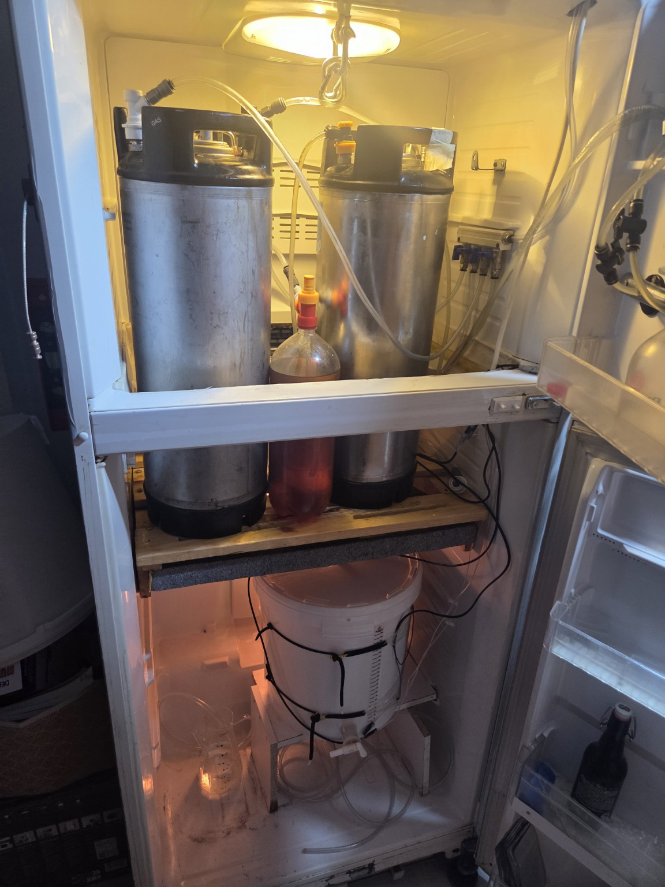
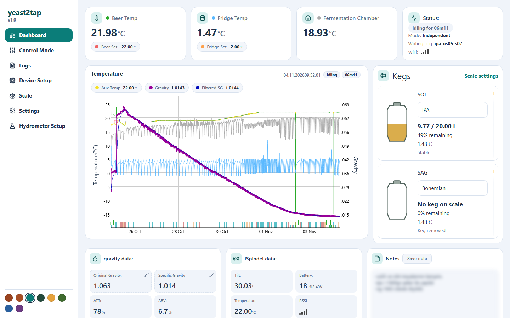
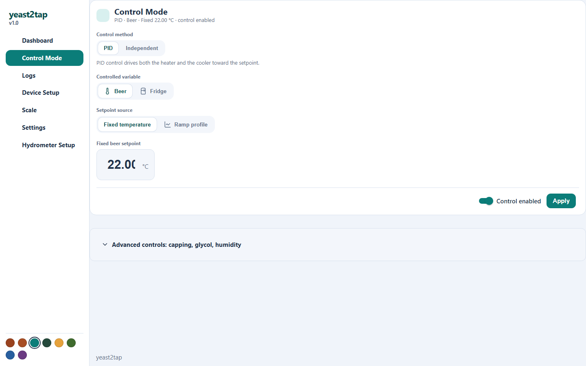
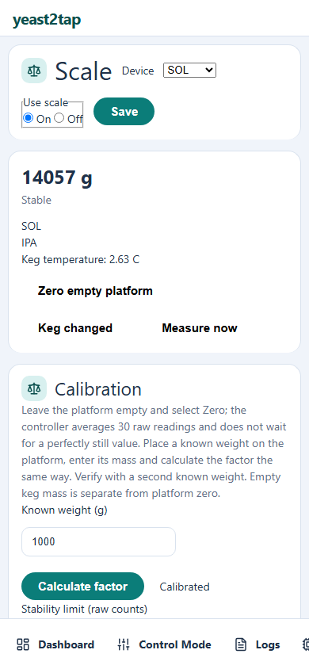

# yeast2tap

A fermentation temperature controller that runs entirely on a single ESP32. No Raspberry Pi, no PC,
no cloud account: the controller, the schedules and the web interface live in one firmware image, and
you reach it from a phone or a laptop on the same network.

[**Download 0.2.4**](https://github.com/asdafe/yeast2tap/releases/tag/v0.2.4) ·
[Source](https://github.com/asdafe/yeast2tap) ·
[Manual](https://github.com/asdafe/yeast2tap/blob/main/documentation/README.md)

---

## One fridge, two jobs

The reference build is a single upright fridge split into two zones with a sheet of foam insulation:
kegs on top, a fermenting bucket below, one ESP32 running both.



---

## What it does

- Temperature control for one chamber — heating, cooling, fan, light, door, humidity and glycol.
- Beer, Fridge, Profile and Independent control modes, with PID and 10-step beer profiles.
- Up to eight HX711 keg scales, with weight history and consumption tracking.
- iSpindel, GravityMon, Tilt and RAPT Pill hydrometers.
- Local logging with an in-browser viewer and CSV export; remote logging and MQTT.
- Eight interface languages: English, Chinese, Italian, Norwegian, Portuguese (BR), Slovak, Spanish
  and Turkish.

## Screenshots







More in the [screenshot index](assets/screenshots/README.md).

---

## Install

Two prebuilt single-file images are published for the ESP32 WROOM 4 MB board — the standard build and
a developer build with BTHome support:

- [yeast2tap-0.2.4-esp32.bin](https://github.com/asdafe/yeast2tap/releases/download/v0.2.4/yeast2tap-0.2.4-esp32.bin)
- [yeast2tap-0.2.4-esp32-dev.bin](https://github.com/asdafe/yeast2tap/releases/download/v0.2.4/yeast2tap-0.2.4-esp32-dev.bin)

```bash
esptool.py --chip esp32 --port COM5 --baud 460800 write_flash 0x0 yeast2tap-0.2.4-esp32.bin
```

Both are merged images written at address `0x0`. Then join the `yeast2tap` Wi-Fi network, open
`http://192.168.4.1`, and log in as `yeast2tap` / `yeast2tap`. The full procedure, the hardware
requirements and the pin map are in the
[manual](https://github.com/asdafe/yeast2tap/blob/main/documentation/README.md).

## Licence

GPL v3. yeast2tap is a fork of [BrewPiLess](https://github.com/vitotai/BrewPiLess), which derives
from BrewPi.
