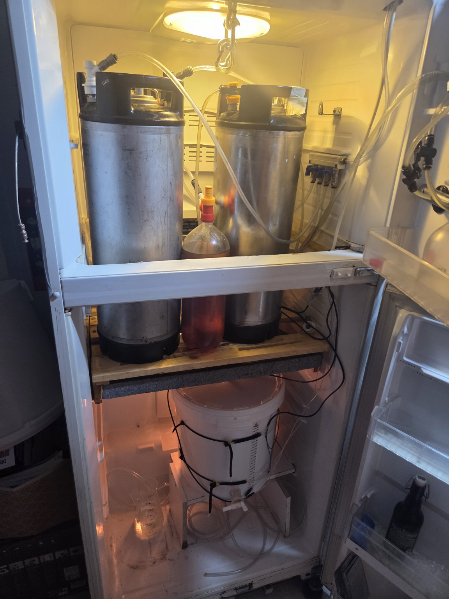

# Hardware

> **Compatibility.** yeast2tap is electronically and sensor-wise fully compatible with BrewPiLess
> hardware: the same boards, sensors and default pin assignments can be used. The project itself has
> only been tested on the **ESP32 WROOM 4 MB** module.

This page describes what the firmware expects, and — just as important — what it does not specify.
Anything the code cannot establish is listed as such rather than guessed.

---

## 1. The controller board

| Item | Value | Where it comes from |
|---|---|---|
| Microcontroller | ESP32 (`esp32dev` board definition), 4 MB flash | `platformio.ini`, `partition2.csv` |
| Framework | Arduino for ESP32, `espressif32@~6.8.1` | `platformio.ini` |
| Tested module | ESP32 WROOM, 4 MB | project statement above |
| Flash layout | two OTA app slots (1,769,472 bytes each) + 589,824-byte filesystem | `partition2.csv` |
| Filesystem | LittleFS | `Config.h` |
| Wireless | 2.4 GHz Wi-Fi (station, access point, or both) | `WiFiSetup.cpp` |
| Bluetooth | BLE for Tilt and RAPT Pill hydrometers | `BleListener.cpp` |

**The 4 MB size matters.** The partition table addresses the whole 4 MB chip: `app0` at
`0x10000`, `app1` at `0x1C0000`, the filesystem at `0x370000`. A 2 MB module cannot hold this
layout. Larger modules would work but nothing in the build uses the extra space.

**Two OTA slots are deliberate.** An update is written to the inactive slot while the current
firmware keeps running, so a failed upload cannot leave the controller without a working image.

### The reference chamber

The project was developed and tested in a single upright fridge that does two jobs at once. Kegs
occupy the top, a fermenting bucket sits below, and the two halves are **separated by a sheet of foam
insulation** placed across the middle of the cabinet. The insulation lets each side hold a different
temperature while one controller and one firmware run the whole box.

This is not a requirement — a plain single-zone fridge works, and so does a chamber with no kegs at
all. It is here so you can see that one ESP32 is enough for a build where fermentation and serving
happen in the same cabinet.

---

## 2. Optional hardware

Every item below is optional. Without it the controller still runs; the related feature simply
stays switched off.

| Optional part | What it enables | Interface / pin |
|---|---|---|
| I²C character LCD, 20×4 | Local display of temperatures and state | I²C, address auto-detected (0x27 assumed) |
| SSD1306 OLED | Same, small display | I²C, address 0x3C assumed |
| Rotary encoder | Local menu navigation | GPIO 13 (A), 14 (B), 18 (switch) |
| Buzzer | Sensor-loss alarm | GPIO 4 |
| Door switch | Door-open detection | GPIO 34 (input only) |
| Pressure transducer | Pressure monitoring, spunding support | ADC1 GPIO 36, or ADS1115 at 0x48 |
| HX711 + load cell | Keg level and consumption | any two free GPIOs per scale, up to eight scales |
| DS2413 1-Wire PIO | Two extra outputs on the 1-Wire bus | 1-Wire bus, GPIO 23 |
| Temp/humidity sensor (DHT11/12/21/22) | Chamber or room humidity, plus its temperature channel | one GPIO per sensor |
| Second temperature probe | A second beer or room reading | 1-Wire bus (or a network-published value) |

Two things in that table deserve a warning:

- **The rotary encoder uses GPIO 13, 14 and 18.** It is enabled by default on ESP32 and those three
  pins are rejected for a scale. They were moved off 25/32/33 so the two keg-scale defaults
  (25/26 and 27/33) work without re-wiring; see
  [Wiring and pins](02-wiring-and-pins.md#5-the-two-keg-scales-and-the-encoder).
- **DS2413 is output-only in this build.** The sense (input) mode is compiled out, so a DS2413 can
  only drive a relay or an SSR, never read a switch.

### Sonoff TH Origin / TH Elite

These integrated boards are `[env:esp32-sonoff]`: OLED, no humidity control, no parasite control. Their
RJ9 sensor jack carries a small controller board inside the plug, so a plain DS18B20 cannot be used
until that is dealt with. Two ways out, neither of which the firmware cares about:

- Remove the controller from the cable and reconnect the two signal wires (not verified on hardware).
- Use a "Sonoff AL010 2.5 mm audio jack to RJ9 adapter" with an ordinary sensor.

The TH Elite's own LCD can be replaced by an I²C OLED. Solder SDA to the `WR` pad and SCL to the `CS`
pad, take 3.3 V and ground from the neighbouring pads, and put hot glue over the joints — the pads
lift easily. Insulate the old LCD board with tape so it cannot touch the main PCB, and be gentle with
the front glass.

---

## 3. What the firmware does *not* define

These are hardware facts a documentation set cannot invent. They are properties of your build, not
of the firmware:

- **Which relay or SSR board you use**, how many channels it has, and whether its inputs are
  active-low or active-high. The device enumeration *assumes* inverted outputs ("the shield has a
  transistor on it"), which is a hint, not a specification.
- **Power supply sizing**: 5 V versus 3.3 V rails, current for the ESP32, the relays and the load
  cells. Nothing in the code constrains this.
- **The ESP32 board variant** beyond `esp32dev`: WROOM versus WROVER, 30 versus 38 pins, which USB
  serial chip, whether BOOT and EN buttons are exposed.
- **The LCD panel** beyond "20×4 at 0x27" or "SSD1306 at 0x3C". The firmware probes for the
  address, but the physical panel size is not asserted anywhere.
- **The HX711 board variant and load-cell capacity.** The firmware only bit-bangs the two pins and
  reads 24-bit counts; it never drives the rate pin, so the chip runs at its default rate.
- **DS18B20 cabling, count and parasite power.** Parasite-powered sensors are skipped in this build.
- **Enclosure, DIN rail, fusing, mains isolation.** Electrical safety is entirely your
  responsibility; the controller side is low voltage, the switching side usually is not.

If you are documenting *your* build, record these facts there. They do not belong in a general
manual because they will be wrong for the next reader.

---

## 4. Electrical notes that the code does imply

- **The 1-Wire bus is fixed to GPIO 23.** It is not configurable in this build; sensors and DS2413
  devices all share it.
- **I²C is fixed to GPIO 21 (SDA) and 22 (SCL).**
- **The pressure input must be an ADC1 pin.** The firmware has a compile-time check that fails the
  build if the pin is moved to ADC2, because ADC2 is unusable while Wi-Fi is active.
- **Input-only pins (34, 35, 36, 39) cannot drive anything.** They are acceptable for an HX711 data
  line or the door switch, never for a clock line or a relay.
- **GPIO 6–11 are the flash lines** and are never usable.
- **GPIO 0, 2, 5, 12 and 15 are boot-strapping pins.** Wiring a relay to one of them can prevent the
  board from starting, or make it start in the wrong mode.

The full rule set, including what the firmware enforces versus what the interface merely warns
about, is in [Wiring and pins](02-wiring-and-pins.md).

---

## 5. A minimal working build

The smallest configuration that can control a fermentation:

1. ESP32 WROOM 4 MB board.
2. One DS18B20 for the beer (on the 1-Wire bus).
3. One DS18B20 for the fridge (same bus).
4. One relay output for heating.
5. One relay output for cooling.
6. A 5 V supply sized for the board and the relay coils.

Everything else — display, buzzer, door switch, hydrometer, scales, pressure, humidity, glycol — is
additive. The controller starts with **no devices assigned at all**; you assign them on the Device
Setup page after the first boot. That is by design: nothing is hard-wired to a pin out of the box,
so the same firmware fits many builds.

---

**Figure:** [A minimal yeast2tap build: ESP32, two probes on the 1-Wire bus, and two relay outputs] `"YT-058-device-setup-full.png"`

The figure shows how the controller looks once the minimum is assigned: a heater and a cooler
actuator, a beer and a fridge probe, and the room probe if you have a third sensor. The exact pins
in the picture are examples; your wiring decides them.

---

## Next

- [Wiring and pins](02-wiring-and-pins.md) — the rules that decide which GPIOs are safe
- [Build from source](03-build-from-source.md) — producing the binary
- [Flashing](04-flashing.md) — getting it onto the board
