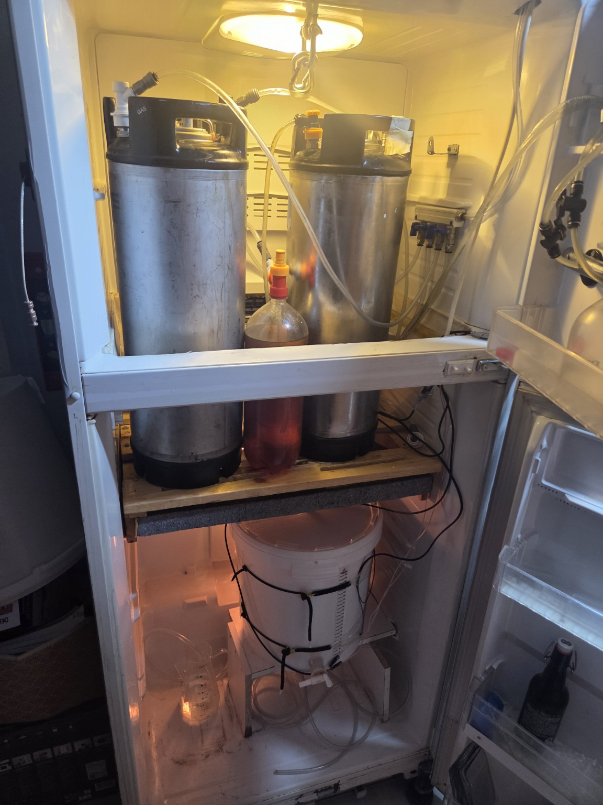

# Getting started

yeast2tap is a fermentation temperature controller that runs entirely on one ESP32. It does not need
a Raspberry Pi, a PC, or a cloud account. You open its web page from a phone or a laptop on the same
network.

> **Compatibility.** Fully compatible with BrewPiLess hardware; the same boards, sensors and default
> pin assignments work. Only tested on the ESP32 WROOM 4 MB module.

The reference build is a single fridge split into two zones by a sheet of foam insulation: kegs on
top, a fermenting bucket below, one ESP32 running both. You do not need that layout — a plain fridge
works — but it is what the screenshots in this manual were taken on.

---

## 1. Finding the device

| Situation | Address |
|---|---|
| never configured | join the `yeast2tap` Wi-Fi, open `http://192.168.4.1` |
| joined your network | `http://<hostname>.local` or the IP from Settings |
| unknown | look in your router's client list, or join the fallback AP |

Login: `yeast2tap` / `yeast2tap` until you change it.

The page works before anything is configured — the interface is part of the firmware, not of the
filesystem.

---

## 2. The eight pages

| Page | What it is for |
|---|---|
| **Dashboard** | current temperatures, the chart, kegs, gravity, notes |
| **Control Mode** | how the controller decides to heat or cool |
| **Logs** | recording a fermentation, and sending it somewhere else |
| **Device Setup** | assigning every physical sensor and relay |
| **Scale** | keg weights, daily history, temperature correction |
| **Settings** | network, credentials, backup, advanced constants |
| **Hydrometer Setup** | iSpindel, Tilt or RAPT Pill |
| **Pressure** | only visible when you enable it |

**Figure:** [The navigation rail with every page listed] `"YT-003-navigation-desktop.png"`

The Pressure entry is hidden until Settings turns that page on. Everything else is always present.

---

## 3. The dashboard in one look

**Figure:** [The full dashboard: stat cards, chart, kegs, gravity, notes] `"YT-001-dashboard-full.png"`

Four regions, top to bottom:

1. **Stat cards** — Beer, Fridge, Room, and a Status card. Each card's checkbox toggles the matching
   line on the chart.
2. **The chart** — the temperature history from the current log, with a legend you can click.
3. **Kegs** — one row per scale, with level, consumption and notes.
4. **Side column** — gravity, the gravity device, notes, plus optional panes for glycol, spunding
   and pressure.

**Figure:** [The four stat cards, close up] `"YT-009-stat-cards.png"`

Nothing here is editable except three things: the room label (double-click), the gravity values
(click), and the notes (type and press Save).

---

## 4. The one mental model you need

The controller has a **beer setpoint** and a **fridge setpoint**, and they are not the same kind of
thing:

- In **Beer** control you set the beer temperature you want. A PID loop continuously computes the
  fridge temperature required to get there, and the relays then hold the fridge at that computed
  value.
- In **Fridge** control you set the fridge temperature directly, and the beer follows whatever the
  fridge does.

So in Beer control, the "Fridge Set" number on the dashboard **moves on its own**. That is the PID
output, not a setting. If you type a fridge setpoint in Beer mode it is overwritten within a second.

This single fact explains most of the "why is my fridge setting changing" confusion.

---

## 5. What the controller does *not* do

Worth stating plainly, so you do not look for it:

- **One chamber, one beer.** The device model has slots for more, but only chamber 1 and beer 1 are
  reachable.
- **No on-device CO₂ calculation.** The CO₂ volumes figure exists only in the browser (capping
  calculator and the offline log viewer).
- **No cloud account.** Remote logging pushes to services you configure; there is no vendor backend.
- **No TLS.** The web interface is plain HTTP.

---

## 6. Where to go next

| If you want to… | Read |
|---|---|
| control a fermentation now | [Control modes](03-control-modes.md) |
| run a temperature schedule | [Profiles and ramps](04-profiles-and-ramps.md) |
| use a hydrometer | [Hydrometers](07-hydrometers.md) |
| use keg scales | [Keg scales](08-keg-scales.md) |
| fix something that is wrong | [Troubleshooting](../troubleshooting/01-web-and-network.md) |

---

## Next

- [Dashboard](02-dashboard.md) — every control, in detail
